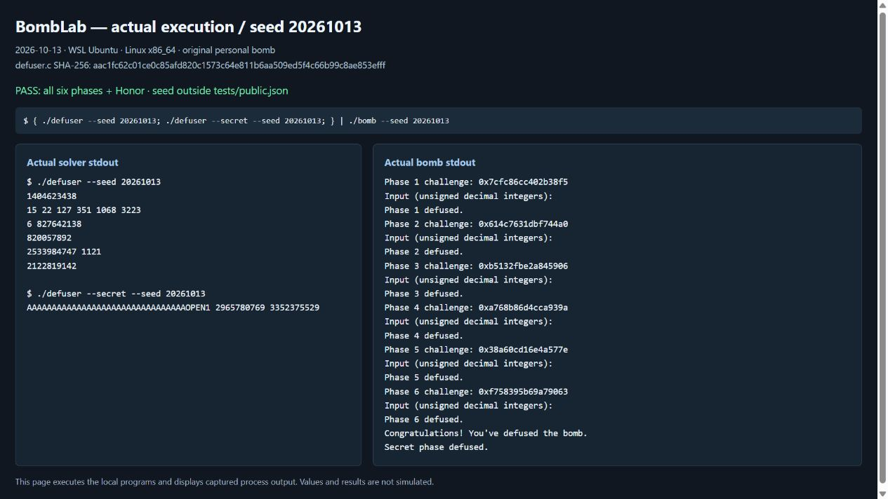
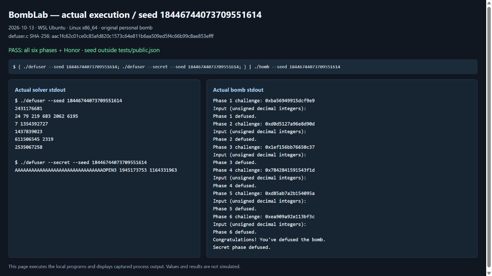

# BombLab 分析与验证报告

环境：WSL Ubuntu、Linux x86_64、GCC 15.2.0、GDB、GNU binutils、Python 3.14.4

本实验完成了个人bomb的六个正式关卡和必做的 Honor。解法的核心是还原每关从输入参数到口令的计算过程：普通关卡使用 `challenge`，Honor 同时使用 `challenge` 和 `context`。这样，seed 改变后可以重新算出口令。报告中的常量、跳转表和节点数据均来自本仓库的个人 `bomb`，适用范围也限于这份二进制。

**辅助工具说明：**本实验使用了 OpenAI Codex，具体用于辅助理解汇编、排查错误，以及整理报告、润色文字和运行截图。本报告包含工具辅助生成、核对和修改的分析文字，不能视为提交者独立推导的全部过程。

## 1. 分析思路与运算约定

分析以原始个人 `bomb` 为依据。`objdump -d --no-show-raw-insn bomb` 用来定位关卡函数，GDB 用来读取数据表和观察 Honor 的调用参数。读取一关时，先看它接受几个字段、怎样比较答案，再沿调用和数据依赖恢复计算。下面的汇编均为关键指令节选，同一代码块中的地址不一定连续。

求解代码位于 `defuser.c`。六关的字段数依次为 `1、6、2、1、2、1`，统一输出空格分隔的无符号十进制整数；Honor 输出一行文本。求解函数写入以 NUL 结尾的字符串，成功返回 0，容量不足或格式化失败返回非零。换行由原驱动添加，求解函数不向 stdout 输出日志。实现仅使用内存计算和 `snprintf`，符合接口对运行方式的限制。

下面用 `C` 表示 64 位无符号 challenge，`U32(v)` 表示取低 32 位，`^` 表示按位异或，`>>` 表示逻辑右移。从 `C`、`context` 提取位段时先做 64 位移位，其余口令计算按 32 位无符号语义进行，加法和乘法按模 2³² 回绕。这一点由汇编使用的寄存器宽度决定。例如，`U32(C >> n)` 是先右移再截断，提前截成 32 位会丢掉后续仍需参与计算的高位。

下文各关的计算示例统一使用非公开 seed `20261013`，各关 challenge 由原驱动生成，完整运行记录和复现命令见第 9 节。

### seed 改变时，哪些内容会变

原驱动通过 `challenge_from_seed(seed, phase)` 为每关生成 challenge。seed 会改变分支选择、递归目标和遍历路径，关卡算法、常量与静态数据表则保持固定。因此，求解器要实现的是每关的完整映射 `f_i(challenge)`。第 5 关保存节点表、第 6 关保存函数指针表，都是在还原题目数据，不是在保存某些 seed 的答案。

Honor 还依赖前六关的输出。原驱动会重新计算六行答案，用 `transcript_context(lines)` 解析其中的十进制字段，并将数值、关号、字段序号逐步混合成 context；随后把它和第七关 challenge 一起传给 `solve_secret`。因此，Honor 必须使用传入的 context，不能固定成某次调试观察到的值。

固定关号后，challenge 生成器在 64 位输入域上是双射：加固定常数可逆，两个奇数乘数在模 2⁶⁴ 下有逆元，`x ^ (x >> k)` 也可从高位向低位恢复。这说明该关的任意 64 位 challenge 都对应某个 seed，不能仅凭常见 seed 的分布排除特殊输入。验证时既直接检查 challenge 的边界和控制位，也反推能产生指定 challenge 的 seed，再运行完整六关与 Honor；具体覆盖情况见第 10 节。

## 2. 第 1 关：函数调用和参数传递

这关只要求一个整数，主要工作是跟清三个 helper 的参数。`p1_compute` 先把 challenge 分成低 32 位、高 32 位，以及右移 16 位后的低 32 位，再依次调用三个函数：

```asm
401fe5: mov    %rdi,%rax
401fe8: mov    %rdi,%rdx
401feb: mov    %edi,%r8d
401fee: shr    $0x20,%rax
401ff2: shr    $0x10,%rdx
401ff6: mov    %eax,%r9d
401ff9: mov    %eax,%esi
401ffe: call   401fb0 <p1_step0>
402003: mov    %rdx,%rsi
402006: mov    %r9d,%edi
402009: mov    %eax,%ecx
40200b: call   401fc0 <p1_step1>
402010: mov    %r8d,%esi
402013: mov    %eax,%edi
402015: call   401fd0 <p1_step2>
40201b: xor    %ecx,%eax

401fb4: lea    (%rdi,%rsi,2),%eax
401fb7: xor    $0x611d,%eax
401fc4: xor    $0x5a93,%esi
401fca: lea    (%rsi,%rdi,8),%eax
401fd4: lea    (%rdi,%rdi,4),%eax
401fd7: add    %esi,%eax
401fd9: xor    $0x33b3,%eax
```

按 System V AMD64 ABI，前两个整数参数使用 rdi/rsi，32 位参数读取 edi/esi，32 位返回值在 eax。结合调用前的赋值，可得到 `step0(L,H)`、`step1(H,M)` 和 `step2(B,L)`；第一个返回值 A 暂存在 ecx，最后再异或进结果。由此恢复出：

```text
L = U32(C)
H = U32(C >> 32)
M = U32(C >> 16)
A = (L + 2*H) ^ 0x611d
B = 8*H + (M ^ 0x5a93)
答案 = ((5*B + L) ^ 0x33b3) ^ A
```

这里的 `lea` 用来做加法和倍乘，并没有读取对应地址的内存。例如 `(%rdi,%rsi,2)` 对应 `L+2*H`，`(%rdi,%rdi,4)` 对应 `5*B`。本例中 A 为 `975447952`，B 为 `1857048856`；将 B 和 L 代入第三步，再与 A 异或，得到下面的口令。这里列出的中间值均已取低 32 位，代码用 `uint32_t` 与 eax 的宽度对应。

非公开 seed `20261013`：challenge `0x7cfc86cc402b38f5`，输出 `1404623438`，原炸弹实际返回 `Phase 1 defused.`。

## 3. 第 2 关：六元素递推与重叠位窗口

这关先检查六个整数。循环中的 `lea (%rsi,%rsi,2),%esi` 将上一项乘 3，`shr` 和 `and` 从 challenge 中取本轮位段，随后加下标并异或。恢复递推关系时，还要单独跟踪 ecx 中的移位计数：

```asm
4020f0: shr    $0x23,%rax
4020f4: and    $0x1f,%eax
4020f7: add    $0x9,%eax
4020fe: mov    $0xd,%ecx
402103: mov    $0x1,%edx
402108: mov    %r13,%rax
40210b: lea    (%rsi,%rsi,2),%esi
40210e: shr    %cl,%rax
402111: and    $0x3f,%eax
402114: add    %edx,%eax
402116: xor    %esi,%eax
402118: mov    -0x40(%rbp,%rdx,4),%esi
402120: add    $0x1,%rdx
402124: add    $0x4,%ecx
402127: cmp    $0x6,%rdx
40212b: jne    402108 <phase_02+0x88>
```

输出六个数，计算关系为：

```text
a[0] = ((C >> 35) & 31) + 9
对 i = 1..5：
    part = (C >> (9 + 4*i)) & 63
    a[i] = (3*a[i-1]) ^ (part + i)
```

`0x3f` 表示取六位，但 ecx 从 13 开始，每轮只加 4。因此五次右移是 `13、17、21、25、29`，相邻窗口重叠两位；位段宽度和窗口步长需要分别判断。循环从 i=1 开始，到 i=6 时退出，连同初值恰好生成六项。

以本节的非公开输入为例，初值是 15，前两个 part 分别为 58、59。于是 `a[1] = 45 ^ 59 = 22`，`a[2] = 66 ^ 61 = 127`。这里异或的是 `part+i`，不是只异或 part。后续按相同规则得到 351、1068、3223。

非公开 seed `20261013`：challenge `0x614c7631dbf744a0`，输出 `15 22 127 351 1068 3223`，实际返回 `Phase 2 defused.`。

## 4. 第 3 关：跳转表的实际索引顺序

这关有两个字段。比较指令先要求第一个字段等于 `s = C & 7`，再把 `x = U32(C >> 3) ^ U32(C >> 32)` 交给分派函数，计算第二个字段。关键是确定 selector 对应哪个分支：

```asm
402291: and    $0x7,%edi
402294: cmp    %edi,-0x18(%rbp)
40229f: shr    $0x3,%rax
4022a3: shr    $0x20,%rsi
4022a7: xor    %eax,%esi
4022a9: call   4021e0 <p3_dispatch>
4021e8: cmp    $0x7,%eax
4021ed: notrack jmp *0x4057e0(,%rax,8)
402208: jmp    4021b0 <p3_case_5>
4021b4: lea    (%rdi,%rdi,1),%eax
4021b7: xor    $0x839,%eax
```

间接跳转的基址是 `0x4057e0`，每项占 8 字节。读取八个地址后，还要沿表项目标处的跳转找到实际 helper。例如 selector 0 先到 `0x402208`，再跳到 `p3_case_5`，对应 `(2*x)^0x839`。因此，helper 名称中的编号不能直接当作 selector：

| s | 跳转表目标 | 实际 helper | 第二个字段 |
|---:|---|---|---|
| 0 | 0x402208 | p3_case_5 | `(2*x) ^ 0x839` |
| 1 | 0x402210 | p3_case_3 | `(x ^ 0x2cba) + (x >> 1)` |
| 2 | 0x402218 | p3_case_1 | `5*x + 0x304a3` |
| 3 | 0x402220 | p3_case_4 | `(x ^ 0x7fc7) + (x >> 2)` |
| 4 | 0x402228 | p3_case_6 | `5*x + 0x4d92` |
| 5 | 0x402230 | p3_case_0 | `(4*x) ^ 0xbaff` |
| 6 | 0x4021f8 | p3_case_7 | `5*x + 0x29a04` |
| 7 | 0x402200 | p3_case_2 | `3*x + 0x7ee0` |

输出为 `s result`。本节输入的低三位是 6，构造出的 x 为 `1883481246`，应使用表中 `s=6` 对应的 `5*x+0x29a04`；结果取低 32 位后为 `827642138`。这一例也体现了为什么需要核实跳转表的顺序，而不能照 helper 名称填写 switch。

非公开 seed `20261013`：challenge `0xb5132fbe2a845906`，输出 `6 827642138`，实际返回 `Phase 3 defused.`。

## 5. 第 4 关：二分递归及回溯计算

`phase_04` 从 challenge 中直接取 `target = C & 127`，设置初始区间 `[0,127]`，并令 `bias = U32(C >> 7) ^ U32(C >> 32)`。所以本关要求的数不是待猜的 target，而是递归函数的返回值。分析需要分两部分：下降时怎样选区间，返回时怎样累计结果。

```asm
4022c4: mov    %edi,%eax
4022c6: mov    %edx,%edi
4022c8: sub    %esi,%edi
4022ca: shr    $1,%edi
4022cc: add    %esi,%edi
4022ce: cmp    %eax,%edi
4022d0: je     402320 <p4_walk+0x60>
4022d7: lea    (%rdi,%rcx,1),%ebx
4022de: cmp    %edi,%eax
4022e0: jb     402300 <p4_walk+0x40>
4022e2: lea    0x1(%rdi),%esi
4022e7: call   4022c0 <p4_walk>
4022ec: lea    (%rax,%rax,2),%eax
4022ef: xor    %ebx,%eax
4022f6: xor    $0x2,%eax
402300: lea    -0x1(%rdi),%edx
402305: call   4022c0 <p4_walk>
40230a: lea    (%rax,%rax,2),%eax
40230d: xor    %ebx,%eax
402314: xor    $0xb,%eax
402320: lea    0x7(%rdi),%eax
402323: xor    %ecx,%eax
```

入口的四个参数依次为 target、low、high、bias，位于 edi、esi、edx、ecx。函数把 target 暂存到 eax，再用 `high-low`、右移一位、加 low 算出中点 middle。相等时直接返回；不相等时，`jb` 按无符号比较决定是否走左区间，另一分支走右区间。ebx 保存本层的 `middle+bias`，递归返回后，子结果先乘 3，再与 ebx 及分支常数异或。于是得到：

```text
F(target, low, high, bias)：
    middle = low + ((high-low) >> 1)
    target == middle：返回 (middle+7) ^ bias
    target < middle：
        child = F(target, low, middle-1, bias)
        返回 (3*child) ^ (middle+bias) ^ 11
    target > middle：
        child = F(target, middle+1, high, bias)
        返回 (3*child) ^ (middle+bias) ^ 2
答案 = F(target, 0, 127, bias)
```

本节输入对应 `target=26`、`bias=2112957770`。递归中点依次是 `63→31→15→23→27→25→26`，到 26 时命中，返回 `(26+7)^bias = 2112957803`。接着回到 middle=25 的右分支，算出 `69379360`，再逐层向上回溯，最外层返回 `820057892`。只记录下降时的左右方向，还不足以算出口令。

递归过程中始终有 `0 <= low <= target <= high <= 127`。相等时先返回，因此 middle 为 0 时不会再进入 `middle-1` 的分支；右端点的处理同理。区间每次严格缩小，最多八层调用，包含最初一层。

非公开 seed `20261013`：challenge `0xa768b86d4cca939a`，输出 `820057892`，实际返回 `Phase 4 defused.`。

## 6. 第 5 关：结构体布局与链表遍历

这关先从起点表中选一个节点，再沿 next 指针访问若干次，每次更新累积值，最后输出累积值和末次访问的 tag。恢复时需要同时确定结构体布局、起点表和循环次数，单看节点数值不够。

`p5_heads` 位于 `0x405b20`，`p5_nodes` 位于 `0x405b60`。`mov (%rdx),%rdx` 读取 8 字节指针；对 `0x8(%rdx)`、`0xc(%rdx)` 的访问各读取 32 位字段。结合相邻节点相差 16 字节，可确定布局为 next 偏移 0、tag 偏移 8、bias 偏移 12：

```asm
4023bd: and    $0x7,%eax
4023c0: shr    $0x3,%rcx
4023c4: mov    0x405b20(,%rax,8),%rdx
4023cf: shr    $0x20,%rdi
4023d3: shr    $0x6,%rax
4023d7: xor    %edi,%eax
4023d9: mov    0x8(%rdx),%esi
4023de: xor    $0xa072,%eax
4023e3: lea    (%rax,%rax,2),%eax
4023e6: add    0xc(%rdx),%eax
4023e9: mov    %esi,(%r8)
4023ec: xor    %esi,%eax
4023ee: and    $0x3,%edi
4023f8: mov    (%rdx),%rdx
4023fb: lea    (%rax,%rax,2),%eax
402401: mov    0x8(%rdx),%esi
402404: add    0xc(%rdx),%eax
402407: xor    %esi,%eax
402409: mov    %esi,(%r8)
```

将节点按地址顺序编号 0..11，并把 next 地址换算成编号，得到下表。表中的十六进制数是节点字段，尚不是最终口令。

| 节点编号 | next 编号 | tag（十六进制） | bias（十六进制） |
|---:|---:|---:|---:|
| 0 | 1 | b53 | d0ef |
| 1 | 11 | 552 | 4148 |
| 2 | 0 | 01b | 45ce |
| 3 | 6 | 168 | de8e |
| 4 | 2 | 90f | 59be |
| 5 | 8 | 64f | 4061 |
| 6 | 5 | 775 | 716f |
| 7 | 9 | 367 | ae83 |
| 8 | 10 | 83d | 8554 |
| 9 | NULL | 23c | 4651 |
| 10 | 4 | a51 | 50dd |
| 11 | 7 | 461 | ce89 |

八个起点的节点编号依次是 `{3,6,5,8,10,4,2,0}`。恢复的计算为：

```text
head_index = C & 7
visits = 1 + ((C >> 3) & 3)
node = heads[head_index]
accumulator = U32(C >> 6) ^ U32(C >> 32) ^ 0xa072
重复 visits 次：
    accumulator = (3*accumulator + node.bias) ^ node.tag
    last_tag = node.tag
    node = node.next
输出 accumulator last_tag
```

次数要把起点算进去：原函数在后续循环前已经更新了一次 accumulator，低位提取出的 0..3 只控制额外访问次数，所以总共是 1..4 次。第二个输出字段取最后一次实际处理节点的 tag。

本节输入的 `head_index=6`，查起点表得到节点 2，`visits=4`。实际处理的节点依次为 `2→0→1→11`，accumulator 从 `2099217918` 开始，四次更新后依次为 `2002704339、1713197883、844644267、2533984747`。最后一个 tag 是节点 11 的 `0x461`，十进制为 1121。求解代码在处理节点 11 后会把指针移向节点 7，但 `last_tag` 保存的仍是节点 11 的 tag。

完整链为 `3→6→5→8→10→4→2→0→1→11→7→9→NULL`。起点表中最靠后的是节点 0，从这里算起仍有五个节点，因此最多四次访问不会解引用 NULL。

非公开 seed `20261013`：challenge `0x38a60cd16e4a577e`，输出 `2533984747 1121`，实际返回 `Phase 5 defused.`。

## 7. 第 6 关：函数指针表和两次间接调用

这关连续进行两次间接调用。两次都查同一张函数指针表，但使用不同的索引，中间还夹着一次异或。先确认调用顺序，再分别还原每个被调函数：

```asm
40251c: shr    $0x6,%rdi
402523: shr    $0x20,%rax
402527: xor    %eax,%edi
402530: and    $0x38,%ebx
402533: and    $0x7,%eax
402536: call   *0x405dc0(,%rax,8)
40253d: xor    $0x3af3,%eax
402542: mov    %eax,%edi
402544: call   *0x405dc0(%rbx)
40254f: add    $0x1950,%eax
402496: rol    $0x2,%eax
4024e6: ror    $0x5,%eax
```

第一次调用按 `(C & 7)*8` 读取指针；第二次调用直接用 `C & 0x38` 作字节偏移。因为每项占 8 字节，后者等价于索引 `(C >> 3)&7`。从 `0x405dc0` 读取八个表项，顺序是 `{op1,op5,op2,op4,op1,op3,op0,op4}`。虽然只有六种函数，索引仍有八种，重复项要按原位置保留。

| 操作 | 地址 | 32 位计算 |
|---|---|---|
| op0 | 0x402490 | `ROL32(x,2) ^ 0x42fd` |
| op1 | 0x4024a0 | `(x ^ 0x22ab) + 2*x` |
| op2 | 0x4024b0 | `(x + 0x98fb) ^ (x >> 3)` |
| op3 | 0x4024c0 | `(4*x + 0xfa0c) ^ (3*x)` |
| op4 | 0x4024e0 | `ROR32(x,5)` |
| op5 | 0x4024f0 | `((x >> 3) ^ x) + 0xa74b` |

```text
first = C & 7
second = (C >> 3) & 7
x = U32(C >> 6) ^ U32(C >> 32)
intermediate = ops[first](x) ^ 0x3af3
答案 = ops[second](intermediate) + 0x1950
```

`rol`、`ror` 是循环移位，移出的位会从另一端补回。本关中分别等价于 `(x << 2)|(x >> 30)` 和 `(x >> 5)|(x << 27)`，操作宽度均为 32 位。代码的旋转辅助函数还对计数及互补计数取模 32，避免计数为 0 时出现移位 32 位的未定义行为。

本节输入的两个索引是 `first=3`、`second=4`，所以先执行 op4，再执行 op1。初始 x 为 `2600380186`，右旋后是 `3570922808`，与 `0x3af3` 异或得到 `3570913227`；送入 op1 得到 `2122812662`，最后加 `0x1950`，输出 `2122819142`。这里的异或在两次调用之间，交换次序就改变了计算。验证时按索引覆盖全部 64 种组合，也保留了表中重复项的位置。

非公开 seed `20261013`：challenge `0xf758395b69a79063`，输出 `2122819142`，实际返回 `Phase 6 defused.`。

## 8. Honor：对象内标记与 transcript context

Honor 的入口和普通关卡不同：输入先经过 `secret_gate` 的长度、标记检查，再把其中的数值部分交给 `secret_phase`。因此需要分别解决字节布局和数值计算，不能只算出三个整数就结束。

`secret_copy` 连同结尾 NUL 一起逐字节复制输入。`secret_gate` 中，复制目标从 `rbp-0xd0` 开始，标记在 `rbp-0xb0`，数值文本在 `rbp-0xac`；相对目标起点的偏移分别是 0、32、36。

```asm
4026db: lea    -0xd0(%rbp),%r12
4026fc: call   401190 <strlen@plt>
402701: sub    $0x24,%rax
402705: cmp    $0x7f,%rax
402709: jbe    402720 <secret_gate+0x60>
402726: call   4026a0 <secret_copy>
40272b: cmpl   $0x4e45504f,-0xb0(%rbp)
40273d: lea    -0xac(%rbp),%rdi
402744: call   4025e0 <secret_phase>

4026b0: movzbl (%rsi,%rax,1),%edx
4026b4: mov    %dl,(%rdi,%rax,1)
4026b7: add    $0x1,%rax
4026bb: test   %dl,%dl
4026bd: jne    4026b0 <secret_copy+0x10>
```

长度检查先减去 `0x24`，再做无符号的 `<=0x7f` 比较，因此允许的原始长度是 36..163。小于 36 时，减法回绕也会使检查失败。标记要求等于 `0x4e45504f`，在小端机器上对应字节 `4f 50 45 4e`，即 `OPEN`。据此安排输入：前 32 字节填非 NUL 的 `A`，偏移 32..35 填 `OPEN`，从偏移 36 开始放三个数值字段。这利用了复制越过 scratch 字段、写入相邻标记的行为，范围仍在目标对象内，不涉及返回地址。

数值部分同时使用第七关 challenge 和六关答案派生的 context。`secret_phase` 先折叠两个 64 位输入的高低半部，再调用 `secret_mix`；选择字段、混合结果和第三个字段的依赖关系如下：

```asm
402645: and    $0x3,%ecx
402650: imul   $0x17ba,%ecx,%r9d
40265a: shr    $0x20,%rsi
40265e: shr    $0x20,%r8
402662: xor    %r12d,%esi
402665: xor    %r13d,%r8d
402668: shr    $0x10,%r13
40266e: xor    %r13d,%r9d
402671: xor    %r8d,%edi
402674: call   4025c0 <secret_mix>
402679: xor    %r9d,%eax
402681: shr    $0x3,%esi
402684: lea    0x3445(%r8,%rcx,1),%edx
40268c: add    %esi,%edx
40268e: xor    %edx,%eax

4025c6: xor    $0x17ba,%edi
4025cc: shr    $0x3,%eax
4025cf: xor    $0x3445,%eax
4025d4: add    %edi,%eax
```

令 `K` 表示传入的 64 位 context。把 `secret_mix` 的移位、异或、加法按顺序展开，可得：

```text
s = K & 3
P = U32(C) ^ U32(C >> 32)
Q = U32(K) ^ U32(K >> 32)
x = P ^ Q
mixed = ((x >> 3) ^ 0x3445) + (x ^ 0x17ba)
b = mixed ^ (s * 0x17ba) ^ U32(K >> 16)
c = b ^ (Q + s + 0x3445 + (P >> 3))
输出 = 32 个 A + OPEN + s 的十进制 + 空格 + b 的十进制 + 空格 + c 的十进制
```

`OPEN` 后直接写 s，数值文本从偏移 36 开始。s 在 0..3，最多一位，b、c 各最多十位，因此整行最多 `32+4+1+1+10+1+10=59` 个字符，加结尾 NUL 共 60 字节，满足 gate 的长度条件，也小于驱动的 `ANSWER_CAP=256`。求解函数接收现成的 K，不必自行重复实现 transcript 的解析和混合。

非公开 seed `20261013` 的 GDB 观察记录为 `C=0x45a12a673065a44f`、`K=0x0ee3918866bdd235`。代入后 `s=1`、`P=1975815720`、`Q=1751008189`，进而得到 `b=2965780769`、`c=3352375529`。完整输入为：

```text
AAAAAAAAAAAAAAAAAAAAAAAAAAAAAAAAOPEN1 2965780769 3352375529
```

原炸弹实际返回 `Secret phase defused.`。

## 9. 非公开 seed 验证与运行截图

`tests/public.json` 中的公开 seed 为 `0,1,7,42,99,123,2026,65535,987654321,18446744073709551615`。上面各节统一使用列表之外的 `20261013`，便于把计算过程和同一次完整运行对应起来。其输入、challenge 和结果汇总如下；Honor 行中的“32 个 A”表示前缀长度，实际输入见第 8 节。

| 关卡 | challenge / context | 输入 | 原炸弹结果 |
|---|---|---|---|
| 1 | 0x7cfc86cc402b38f5 | 1404623438 | Phase 1 defused. |
| 2 | 0x614c7631dbf744a0 | 15 22 127 351 1068 3223 | Phase 2 defused. |
| 3 | 0xb5132fbe2a845906 | 6 827642138 | Phase 3 defused. |
| 4 | 0xa768b86d4cca939a | 820057892 | Phase 4 defused. |
| 5 | 0x38a60cd16e4a577e | 2533984747 1121 | Phase 5 defused. |
| 6 | 0xf758395b69a79063 | 2122819142 | Phase 6 defused. |
| Honor | C=0x45a12a673065a44f，K=0x0ee3918866bdd235 | 32 个 A + OPEN1 2965780769 3352375529 | Secret phase defused. |

复现命令在仓库根目录、Linux x86_64 环境中执行：

```sh
make
python3 public_test.py
{ ./defuser --seed 20261013; ./defuser --secret --seed 20261013; } | ./bomb --seed 20261013
{ ./defuser --seed 18446744073709551614; ./defuser --secret --seed 18446744073709551614; } | ./bomb --seed 18446744073709551614
```

下面两张图片是本地运行展示页的浏览器截图。页面通过子进程调用 WSL 中的 `defuser` 和原始 `bomb`。其中，左列展示生成的输入，右列展示捕获的炸弹输出，源码标识见第 11 节。展示页只用于记录结果，复现通关可直接使用上面的命令。





此外还验证了 `424242` 和 `9223372036854775808`。2026-10-20 报告复核时，在临时目录按官方 Makefile 重新编译，四个非公开 seed 再次全部通过，共 28 个关卡结果；两张截图对应的六行口令、Honor 口令和炸弹输出，也与保存的原始 JSON 记录逐项一致。此次复测没有修改求解代码。

## 10. 验证方法与结果的适用范围

各关的公式需同时满足数值关系和接口要求。数值算对但字段数、输出长度或 context 不正确，完整运行仍会失败。因此验证分为实际运行、缓冲区接口和数值模型三个部分。

### 实际运行与接口

按官方 Makefile 的 `-std=c11 -O2 -Wall -Wextra -Wpedantic -Werror` 编译成功。主要记录如下：

| 检查 | 范围与目的 | 结果 | 记录日期 |
|---|---|---|---|
| 官方公开测试 | 10 个 seed，检查六关及 Honor | 六关 60/60，Honor 10/10 | 原始验证通过；10-20 复测通过 |
| 非公开示例 | 第 9 节四个 seed，检查完整输入与 context 联动 | 28/28 个关卡结果 | 原始验证通过；10-20 复测通过 |
| 直接 challenge 测试 | 边界、单比特、模式值和确定性随机输入 | 2,595/2,595 | 10-13 |
| 扩展 seed 测试 | 446 个非公开 seed，均运行六关和 Honor | 3,122/3,122 个关卡结果 | 10-13 |
| 错误答案对照 | 分别翻转六关共 13 个输出字段的一位 | 原炸弹全部拒绝 | 10-13 |
| 缓冲区接口检查 | 容量 0..256、恰好容纳、截断、NULL 及前后哨兵 | 115,584/115,584；ASan/UBSan 无错误报告 | 10-13 |

直接 challenge 测试按关分别为 `289、289、311、779、401、526` 项。446 个 seed 中，有 248 个通过反转 challenge 生成器构造，用来在完整运行中覆盖第 3 关全部 8 个分支、第 4 关全部 128 个 target、第 5 关全部 32 种起点/次数组合、第 6 关全部 64 种索引组合，以及前两关指定的边界与模式输入；Honor 也实际覆盖了 4 个 context selector。这些测试均使用课程 `runner.py` 的输出格式和资源限制。表中的四个示例已包含在原始扩展 seed 测试中，单独列出是为了与正文对应。

输出长度还可以直接估计：字段最多的第 2 关，即使保守地把每个数都按十位计算，也只有 `6*10+5=65` 个字符；Honor 上界为 59 个字符。两者加 NUL 后均小于 256。原始检查还启用了 `-Wconversion -Wshadow -Wstrict-prototypes -fanalyzer`，编译无诊断。关键汇编与恢复的数据表也已和原始 ELF 核对。

### 数值模型核查

运行测试只能检查有限个输入，因此原始扩展验证还使用自制的 x86 指令符号解释器和 Z3 5.1.0，对原炸弹及 Makefile `-O2` 编译的解法检查数值接受条件。解释器从 ELF 读取指令和数据，以固定位向量表示 32 位、64 位运算。做法是先枚举有限的控制选择，再让其余输入位自由取值，查询是否存在“求解器输出被炸弹拒绝”的数值反例：

| 关卡 | 枚举对象 | 分区数 | 每分区保持自由的输入位 | 核查结果 |
|---|---|---:|---:|---|
| 1 | 无控制选择 | 1 | challenge 64 位 | 未找到数值反例 |
| 2 | 固定五轮循环 | 1 | challenge 64 位 | 未找到数值反例 |
| 3 | 8 个 selector | 8 | challenge 61 位 | 未找到数值反例 |
| 4 | 128 个 target | 128 | challenge 57 位 | 未找到数值反例 |
| 5 | 8 个起点 × 4 种次数 | 32 | challenge 59 位 | 未找到数值反例 |
| 6 | 8 × 8 个操作索引 | 64 | challenge 58 位 | 未找到数值反例 |
| Honor | 4 个 context selector | 4 | challenge 64 位 + context 62 位 | 未找到数值反例 |

238 个分区的反例查询均返回 UNSAT，即在模型范围内不存在数值反例。Honor 中 challenge 与 context 独立取值，覆盖范围包含实际 transcript 能生成的组合。为检查解释器本身，还用 476 项实际程序输出交叉核对，并做了 16 项错误字段的模型拒绝对照，均符合预期。

这项结论以解释器和模型正确为前提。`snprintf`、字段合法性检查和 `sscanf` 在模型中作了抽象；Honor 的 gate 复制则通过汇编、长度分析和实际完整运行另外检查。因此，它支持各关计算关系对全部输入位成立，但不等同于整个 C 程序及 C 库的形式化证明。接口检查和实际运行仍有各自的作用。

上述扩展统计可在单独保存的“BombLab-通解验证证据-非课程提交”归档中查到：实际运行见 `review-runtime-results.json`，数值模型见 `review-symbolic-results.json`，接口检查见 `buffer-tests.txt`。归档还保存了源码、ELF、脚本和反汇编，用于追溯验证对象；这些文件不参与课程解法的编译运行。

### 历史版本记录

旋转辅助函数整理前的版本曾在 GCC `-O0` 至 `-O3` 下测试，每个变体均完成 2,334 项直接 challenge 检查和 524 个完整 seed 运行，全部通过。该记录对应历史源码哈希 `d0976bdd1d51cfb5895538fbe2003dffeca0d2dd8df87b22c06c437aa4b67071`，原始结果位于证据归档的 `historical/official-stress-results.json`。由于源码版本不同，只保留为补充记录，不计入当前源码的测试数量。


## 11. 对象标识

个人 bomb SHA-256（字节哈希）：

```text
dd4684a670e1648e44f7cf468e6749f4c95e30383e87ae8cbf10d4436347f6b7
```

Windows 工作区 `defuser.c` 的 SHA-256（CRLF 字节，原始验证与本次复核一致）：

```text
aac1fc62c01ce0c85afd820c1573c64e811b6aa509ed5f4c66b99c8ae853efff
```

将 CRLF 统一为 LF 后的 SHA-256：

```text
9723464ce9cc37e7cc201e61b978eb18f2445bb3bd6f0214b968f2a4699b49c3
```

源码哈希用于确定验证的是哪一份代码，不代表生成的可执行文件也具有同一哈希。Git 若把文本保存为 LF，字节哈希会随换行变化，此时可用上述 LF 归一化标识比较。两张截图展示的源码标识与这里一致；历史版本已在第 10 节另行标明。

## 12. 参考资料与辅助工具用途

1. ICS-26Fall-FDU，[Lab2: BombLab 实验说明](https://ics-26fall-fdu.github.io/labs/lab2-bomb-lab/)。用于核对实验目标、通解要求、Honor、报告内容和提交流程。
2. ICS-26Fall-FDU，[BombLab 官方模板仓库及 README](https://github.com/ICS-26Fall-FDU/BombLab)。用于核对求解接口、允许修改的范围、编译方式、公开测试和 `final` 标签提交要求。
3. 本仓库的个人 `bomb`、`defuser.h`、`defuser_main.c`、`challenge.c`、`Makefile`、`public_test.py` 和 `runner.py`。个人 `bomb` 是逆向分析对象；其余文件用于核对接口、challenge/context 来源、编译选项、输出格式及测试限制。
4. GNU，[GDB 官方文档](https://sourceware.org/gdb/current/onlinedocs/gdb.html/)。对应报告中断点、寄存器、调用参数和内存检查等调试操作。此文档链接在本次报告完善时补充，供复核命令功能。
5. GNU，[Binutils `objdump` 官方文档](https://sourceware.org/binutils/docs/binutils/objdump.html)。对应报告中的反汇编、函数定位和指令核对操作。此文档链接在本次报告完善时补充，供复核命令功能。

辅助工具及用途：`objdump` 用于静态反汇编；GDB 用于动态调试和检查运行时数据；GCC 用于按官方 Makefile 编译；Python 用于测试与结果核对；WSL 提供 Linux 运行环境。扩展验证使用的自制指令解释器、Z3 及其结论适用范围见第 10 节。Codex 用于辅助分析与核对汇编、数据表，排查问题，设计验证，以及生成或修改部分报告文字和运行结果展示内容。截图展示页仅呈现捕获的程序输出，不参与求解或课程评分。
